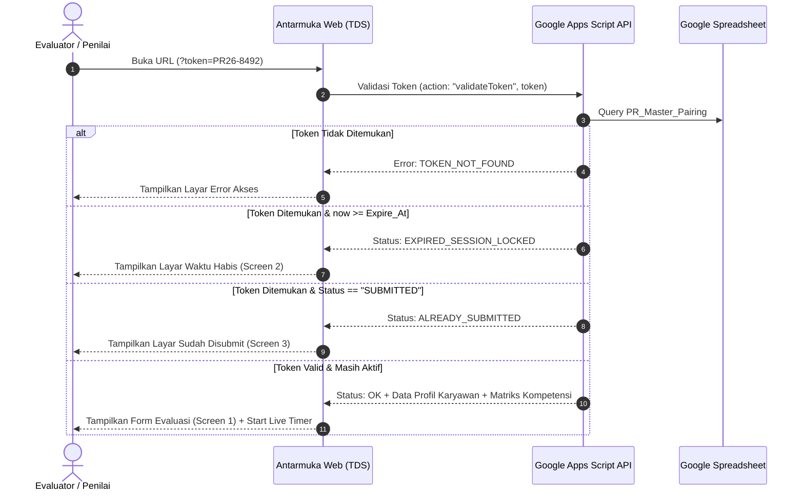

# Spesifikasi Desain: Modul Performance Review (PR) Terpadu TDS

## 1. Ringkasan Eksekutif (Overview)

Dokumen ini mendefinisikan arsitektur sistem, skema data, antarmuka pengguna, dan mekanisme keamanan untuk modul **Annual Performance Review (PR)** di dalam ekosistem TDS (Training & Development System).

### Sasaran & Prinsip Utama:
1. **Dual-Branch Evaluation (Dua Arah)**:
   - **Top-Down Evaluation**: Leader/Atasan mengevaluasi Anggota Tim (60% Kompetensi Teknis & Kepemimpinan + 40% Nilai Inti ELASTIC).
   - **Upward Evaluation (Feedback ke Leader)**: Anggota Tim mengevaluasi Leader/Atasan secara objektif terkait aspek kepemimpinan, *people management*, dan *enabler* kerja tim.
2. **Kerahasiaan Tinggi (Strict Confidentiality)**:
   - Sifat penilaian **sangat rahasia** (*strictly confidential*). Antar rekan sejawat (*peers*) dan antar divisi tidak dapat saling melihat penilaian orang lain.
   - Penilaian hanya dapat diakses oleh **Penilai yang ditunjuk**, **Karyawan yang dinilai**, dan **Tim HR/Approver**.
3. **Distribusi Token Sederhana (6-8 Karakter)**:
   - HR menginput pasangan penilai-karyawan via spreadsheet tab master (`PR_Master_Pairing`).
   - Sistem men-generate token unik pendek, ramah, dan mudah diingat (contoh: `PR26-8492` atau `PR26-9K2M`) yang didistribusikan via email korporat berisikan tautan langsung (`?token=PR26-8492`).
4. **Batas Waktu Pengisian & Auto-Lock (00:00 Deadline)**:
   - Setiap siklus PR memiliki batas periode pengisian (misal: 3 hari kalender).
   - Tepat di hari terakhir pukul **00:00 WIB**, akses formulir otomatis terkunci (*hard cutoff*) melalui proteksi ganda: banner frontend waktu habis dan validasi backend Apps Script yang menolak pengiriman data setelah deadline.
5. **Kerahasiaan Skor Akhir & Portal Kalibrasi HR**:
   - Selama mengisi formulir, penilai **tidak melihat kalkulasi skor komposit / nilai akhir**.
   - Skor akhir dihitung secara tertutup di backend dan baru dapat dilihat, dikalibrasi (termasuk penginputan skor *Kedisiplinan & Presensi* oleh HR), serta dirilis resmi oleh HR melalui **Portal Approver / HR Calibration Hub**.
6. **Kepatuhan Rubrik Skala Asli (Verbatim)**:
   - Skala penilaian 1–4 tetap mempertahankan rumusan resmi perusahaan tanpa perubahan redaksional:
     - `1`: **Kurang (Below Expectation)** — *Tidak memenuhi standar, banyak kesalahan, perlu bimbingan intensif.*
     - `2`: **Cukup (Need Improvement)** — *Mulai memenuhi, namun masih sering perlu arahan & perbaikan.*
     - `3`: **Baik (Meets Expectation)** — *Sudah sesuai standar, mandiri, hasil kerja konsisten.*
     - `4`: **Sangat Baik (Exceeds Expectation)** — *Melebihi ekspektasi, proaktif, hasil sangat optimal & berdampak.*
7. **Desain Anti-Slop & Visual Hierarchy Modern**:
   - Menggunakan palet eksekutif TDS: **Navy & Slate** (`#0F172A`, `#1E293B`, `#2563EB`, `#F8FAFC`).
   - Tata letak ringkas: Header profil eksekutif, rubrik horizontal segmented yang dapat diciutkan (`[Ringkas]`), bagian evaluasi berbasis **dropdown accordion**, dan indikator progres melayang di pojok kanan bawah (`corner-progress-fab`).

---

## 2. Arsitektur UI / UX & Komponen Antarmuka

### 2.1. Alur Layar (Screen States)
Aplikasi memiliki 5 kondisi tampilan (*state*) yang dikendalikan oleh validasi sesi:

| State | Kondisi | Tampilan Antarmuka |
|---|---|---|
| `DIRECTORY` | Akses portal PR tanpa token langsung di URL | Direktori Divisi & Karyawan berstatus Terkunci (*Strict Confidentiality*), box input autentikasi *Cryptic Access Code*, dan tombol buka formulir. |
| `ACTIVE` | Token valid & waktu belum habis (`now < expireAt`) | Formulir lengkap: Rubrik kriteria, Dropdown Bagian I & II, Ulasan Kualitatif Bagian III, Floating Corner Progress, Tombol Simpan Draf & Submit Final. |
| `EXPIRED` | Waktu melebihi deadline (`now >= expireAt` / 00:00 WIB) | Layar peringatan: *Periode Evaluasi Telah Ditutup* (`EXPIRED_SESSION_LOCKED`), waktu deadline resmi, dan kontak People Operations. |
| `SUBMITTED` | Formulir sudah disubmit final | Layar apresiasi: *Evaluasi Telah Berhasil Diserahkan* (`COMPLETED & LOCKED`), ringkasan waktu submit, status tersimpan di brankas HR. |
| `APPROVER` | Akses khusus Tim HR / Approver (PIN/Admin Auth) | Dashboard Monitoring & Kalibrasi Nilai: KPI rekap submission, tabel antrean karyawan, dual-branch comparison viewer, input nilai *Kedisiplinan HR*, kalkulator skor akhir, dan tombol rilis resmi. |

### 2.2. Struktur Formulir Penilai (`ACTIVE` State)
1. **Top Notice Bar**:
   - Banner penegasan kerahasiaan: *"Dokumen Rahasia & Terbatas (Strictly Confidential). Hanya Penilai, Karyawan yang dinilai, dan Tim HR yang memiliki akses."*
   - Timer hitung mundur sisa waktu penutupan (format: `Hari : Jam : Menit : Detik`).
2. **Executive Document Header & Profile**:
   - Badge status dokumen (*Dokumen Rahasia*).
   - Inisial avatar netral (`DA`) dan judul resmi: *Lembar Evaluasi Kinerja & Kompetensi Tahunan 2026*.
   - Detail karyawan: Nama, NIK, Departemen/Divisi, Jabatan, Level/Tier, Tanggal Bergabung.
   - Detail evaluator: Nama Penilai, Hubungan Evaluasi (misal: *Direct Supervisor / Atasan Langsung*), dan Kode Sesi Akses.
3. **Rubrik Skala Penilaian Terpadu**:
   - Format horizontal 4-segmen (1 Kurang, 2 Cukup, 3 Baik, 4 Sangat Baik).
   - Tombol toggle `[Ringkas / Detail Kriteria]` untuk meminimalisasi ruang layar (*low cognitive load*).
4. **Dropdown Accordion Bagian Evaluasi**:
   - **Bagian I: Leadership & Role Competencies (Bobot 60%)**: 6 indikator teknis & kepemimpinan per jabatan. Masing-masing butir menggunakan format **Opsi 3: Kartu Vertikal + Definisi Langsung** (`1 Kurang`, `2 Cukup`, `3 Baik`, `4 Sangat Baik`) dengan deskripsi operasional skala tercantum langsung di tiap kartu pilihan.
   - **Bagian II: ELASTIC — Corporate Core Values (Bobot 40%)**: 7 nilai budaya perusahaan (Enthusiastic, Loving, Adaptive, Synergistic, Trustworthy, Innovative, Consistent).
   - **Bagian III: Ulasan Kualitatif 360°**: Dua area feedback naratif terbuka: *Pencapaian & Kekuatan Utama (Key Strengths)* dan *Area Pengembangan & Saran (Areas for Improvement)*.
   - Tombol kendali cepat: `[Buka Semua / Tutup Semua]` di atas daftar bagian.
5. **Floating Corner Progress Widget (`corner-progress-fab`)**:
   - Indikator progres non-intrusif di sudut kanan bawah layar dengan *circular ring progress* SVG.
   - Menampilkan jumlah item yang telah dinilai secara *real-time* (`13 / 13 Selesai`).
6. **Slim Bottom Action Bar**:
   - Catatan kerahasiaan skor: *"Skor komposit akhir dikalibrasi & dirilis resmi oleh HR di Portal Approver"*.
   - Tombol `[Simpan Draf]` (menyimpan progres sementara ke `localStorage` dan sheet).
   - Tombol `[Submit Evaluasi Final]` (membuka modal konfirmasi dengan kunci permanen setelah diserahkan).

---

## 3. Skema Data Google Spreadsheet (Backend Architecture)

Sistem menggunakan Google Sheets sebagai basis data terpusat dengan 5 lembar kerja (*sheets*):

### 3.1. Sheet: `PR_Master_Pairing`
Menyimpan daftar pasangan penilai dan karyawan yang dinilai, dikelola langsung oleh HR:
| Kolom | Tipe | Contoh Data | Keterangan |
|---|---|---|---|
| `Token_Akses` | String (Key) | `PR26-8492` | 6–8 karakter unik acak |
| `Tipe_Evaluasi` | Enum | `TOP_DOWN` / `UPWARD` | Arah evaluasi |
| `ID_Karyawan` | String | `EMP-2024-082` | NIK Karyawan yang dinilai |
| `Nama_Karyawan` | String | `Dimas Ardiansyah` | Karyawan yang dinilai |
| `Divisi_Karyawan` | String | `Engineering & Tech` | Divisi kerja |
| `Jabatan_Karyawan` | String | `Lead System Architect`| Posisi/Level |
| `Email_Penilai` | String | `leader.budi@perusahaan.com` | Email penerima token |
| `Nama_Penilai` | String | `Budi Pratama, M.Kom` | Nama evaluator |
| `Periode_Mulai` | Datetime | `2026-10-15 08:00:00` | Waktu aktivasi form |
| `Periode_Selesai` | Datetime | `2026-10-18 23:59:59` | Batas akhir pengisian |
| `Status` | Enum | `PENDING` / `DRAFT` / `SUBMITTED` / `EXPIRED` | Status sesi |
| `Submit_At` | Datetime | `2026-10-16 14:22:10` | Waktu submit final |

### 3.2. Sheet: `PR_Matrix_Kompetensi`
Menyimpan daftar kompetensi per role jabatan/divisi:
| Kolom | Tipe | Keterangan |
|---|---|---|
| `Role_Key` | String | Misal: `TECH_LEAD`, `STAFF_OPERATION`, `MARKETING_SPEC` |
| `No_Urut` | Number | Urutan tampilan (1 s.d 6) |
| `Nama_Kompetensi` | String | Misal: `Analytical & Adaptability`, `Attention to Detail` |
| `Deskripsi_Panduan` | String | Perilaku operasional standar |
| `Bobot_Kategori` | Number | Bobot kategori (default: 60%) |

### 3.3. Sheet: `PR_Core_Values`
Menyimpan 7 pilar budaya ELASTIC:
| Kolom | Tipe | Keterangan |
|---|---|---|
| `Pilar_Key` | String | `E`, `L`, `A`, `S`, `T`, `I`, `C` |
| `Nama_Pilar` | String | Misal: `Enthusiastic`, `Adaptive`, `Consistent` |
| `Deskripsi_Perilaku`| String | Penjelasan implementasi nilai di lingkungan kerja |
| `Bobot_Kategori` | Number | Bobot kategori (default: 40%) |

### 3.4. Sheet: `PR_Vault_Submissions` (Brankas Tertutup)
Menyimpan jawaban murni evaluator yang dienkripsi/diproteksi:
| Kolom | Tipe | Keterangan |
|---|---|---|
| `Submission_ID` | String (Key) | `SUB-20261016-8492` |
| `Token_Akses` | String | Referensi token `PR_Master_Pairing` |
| `Scores_Raw_JSON` | JSON String | Nilai per item `{ "comp_1": 4, "comp_2": 4, ... }` |
| `Strengths_Feedback`| Text | Catatan kelebihan & prestasi |
| `Improvement_Feedback`| Text | Catatan area pembenahan |
| `Ip_Address_Hash` | String | Hash alamat IP untuk jejak audit kepatuhan |
| `Timestamp` | Datetime | Waktu pencatatan |

### 3.5. Sheet: `PR_Calibration_Master`
Tempat HR mengelola kalibrasi nilai akhir:
| Kolom | Tipe | Keterangan |
|---|---|---|
| `ID_Karyawan` | String (Key) | NIK Karyawan |
| `Skor_TopDown_Raw` | Float | Rata-rata tertimbang dari atasan |
| `Skor_Upward_Raw` | Float | Rata-rata tertimbang dari tim (jika ada) |
| `Skor_Disiplin_HR` | Float | Nilai kehadiran & kedisiplinan inputan HR (0–100) |
| `Skor_Akhir_Komposit`| Float | Formula resmi: `(0.85 * Skor_Evaluator) + (0.15 * Skor_Disiplin)` |
| `Predikat_Resmi` | String | *Sangat Baik / Baik / Cukup / Kurang* |
| `Catatan_Kalibrasi_HR`| Text | Catatan komite pertimbangan karier |
| `Status_Rilis` | Enum | `DRAFT_HR` / `RELEASED` |
| `Rilis_At` | Datetime | Waktu publikasi resmi ke portal karyawan |

---

## 4. ⚙️ Alur Kerja & Logika Sistem (Workflows)

### 4.1. Alur Akses Berbasis Token & Validasi Waktu

### 4.2. Penguncian Waktu Otomatis (Hard Cutoff 00:00)
1. **Frontend Layer**:
   - `setInterval` menghitung sisa waktu hingga timestamp `Periode_Selesai`.
   - Jika sisa waktu $\le 0$, UI langsung menutup form pengisian dan beralih ke `#screenExpired`.
2. **Backend Apps Script Layer (Security Enforcer)**:
   - Fungsi `doPost` memeriksa `new Date()` terhadap `Periode_Selesai` di baris sheet yang bersangkutan.
   - Jika waktu server melampaui deadline, request ditolak dengan respon HTTP:
     `{ success: false, code: "DEADLINE_EXCEEDED", message: "Periode pengisian telah berakhir pada 00:00 WIB." }`
   - Ini mencegah manipulasi waktu lokal browser (*client-side clock tampering*).

### 4.3. Alur Kalibrasi HR & Penyembunyian Skor (Score Secrecy)
1. Ketika evaluator mengisi dan memilih skor 1–4 pada setiap butir, frontend hanya mencatat nilai butir dan menampilkan badge status pengisian (`Skor: 4 (100)`).
2. **Tidak ada rumus skor akhir, rata-rata komposit, atau predikat yang ditampilkan ke evaluator.**
3. Setelah evaluator menekan *Submit Final*:
   - Data tersimpan ke `PR_Vault_Submissions`.
   - Data agregat dikirim ke `PR_Calibration_Master`.
4. Di **Portal Approver**:
   - HR membuka antarmuka kalibrasi menggunakan otentikasi admin.
   - HR melihat matriks perbandingan nilai atasan, feedback kualitatif, serta memasukkan metrik penilaian internal HR: **Skor Presensi & Kedisiplinan Karyawan (bobot standar misal 10-15%)**.
   - Sistem secara otomatis menghitung *Skor Akhir Komposit Terkalibrasi*.
   - HR menekan tombol `[Setujui & Rilis Hasil Resmi ke Karyawan]`.

### 4.4. Validasi Kelengkapan & Modal Peringatan (Incomplete Reminder Modal)
1. **Pengecekan Komprehensif Saat Submit**:
   - Bagian I (Kompetensi): 6 butir wajib memiliki skor > 0.
   - Bagian II (Nilai ELASTIC): 7 butir nilai korporat wajib memiliki skor > 0.
   - Bagian III (Ulasan 360°): `txtStrengths` dan `txtImprovements` wajib terisi (tidak boleh kosong/hanya spasi).
2. **Peringatan & Deep-Linking Interaktif**:
   - Jika tombol *Submit Evaluasi Final* ditekan saat masih ada butir kosong, sistem memunculkan modal `#incompleteModal`.
   - Modal merinci daftar pertanyaan yang terlewat beserta badge jumlah sisa (`X Butir Belum Diisi`).
   - Evaluator dapat mengeklik tombol *"Lengkapi Butir Pertama &rarr;"* atau butir spesifik: modal tertutup, accordion otomatis terbuka, layar scroll halus ke pertanyaan tersebut, dan pertanyaan mendapatkan efek animasi highlight kuning berdenyut (`item-highlight-pulse`) selama 3 detik.

### 4.5. Mode Template Kosong & Kustomisasi Karyawan Riil (`PR26-BLANK`)
1. **Kebutuhan Pengujian Nyata**:
   - Menyediakan lembar formulir bersih (*blank sheet*) dengan kode token `PR26-BLANK`.
   - Seluruh 13 butir penilaian dan 2 textarea ulasan dimulai dari kondisi kosong murni (`0 / 13 Selesai - 0%`).
2. **Atur Identitas Karyawan Riil (`#editEmployeeModal`)**:
   - Evaluator dapat memasukkan data riil karyawan: Nama, NIK, Divisi (Dropdown + Kustom), Posisi/Jabatan, dan Nama/Jabatan Penilai.
   - Pilihan **Preset Kompetensi Peran (Bagian I)**:
     - *Standar Korporat Umum (Universal)*
     - *Teknologi & Engineering*
     - *Finance & Accounting*
     - *Sales, Marketing & Creative*
     - *Operations & People Operations (HR)*
   - Opsi *checkbox* untuk mereset seluruh skor ke 0 atau mempertahankan penilaian yang sudah dipilih.
3. **Sinkronisasi Multi-Screen**:
   - Data karyawan kustom tersinkronisasi otomatis ke kartu Direktori Divisi, Lembar Form Aktif, Banner Khusus, dan Tabel Monitoring di Portal Approver HR.

---

## 5. Manifestasi File & Perubahan Kode (File Manifest)

| File | Tipe | Peran & Deskripsi |
|---|---|---|
| `preview-performance-review.html` | File Baru (Pratinjau) | Prototipe interaktif mandiri yang menyajikan 4 state simulasi, rubrik asli, dropdown accordion, dan dashboard approver HR. |
| `performance-review.html` | Halaman Baru | Halaman produksi utama untuk evaluasi kinerja karyawan dengan routing token URL. |
| `css/performance-review.css` | Styling | CSS terisolasi untuk modul PR berpalet TDS Slate Navy (`#0F172A`) dengan responsivitas mobile anti-collision penuh. |
| `js/performance-review.js` | Skrip Modul | Logika validasi token, timer mundur, kalkulasi progress ring, auto-save draf, dan handler submit. |
| `google-apps-script.js` | Backend Script | Penambahan fungsi API backend: `handlePRTokenValidation()`, `handlePRSubmission()`, `handlePRHRCalibration()`, serta daily reminder trigger. |

---

## 6. Rencana Verifikasi & Pengujian (Verification Plan)

### 6.1. Pengujian Integritas Skala Penilaian
* Memastikan 100% teks panduan skala di kartu rubrik dan tombol memilih nilai sesuai standar resmi:
  - 1: Kurang (Below Expectation)
  - 2: Cukup (Need Improvement)
  - 3: Baik (Meets Expectation)
  - 4: Sangat Baik (Exceeds Expectation)

### 6.2. Pengujian Skenario Akses & Keamanan
1. **Token Valid**: Masuk dengan token aktif (`PR26-8492`) memuat data profil Dimas Ardiansyah secara mulus.
2. **Waktu Habis (00:00 Auto-Lock)**: Simulasi waktu lampau memunculkan `#screenExpired` dan menolak pengiriman data di backend.
3. **One-Time Submit**: Token yang sudah berstatus `SUBMITTED` tidak dapat mengisi ulang dan langsung menampilkan `#screenSubmitted`.
4. **Penyembunyian Skor**: Memastikan tidak ada elemen skor kumulatif yang bocor di DOM formulir pengisian.

### 6.3. Validasi Sintaksis & Standar Proyek
* Menjalankan `node -c js/performance-review.js` dan `node -c google-apps-script.js` sebelum deploy.
* Memastikan seluruh form responsif pada viewport mobile ($\le 768px$) tanpa overflow dan tanpa collision teks.
